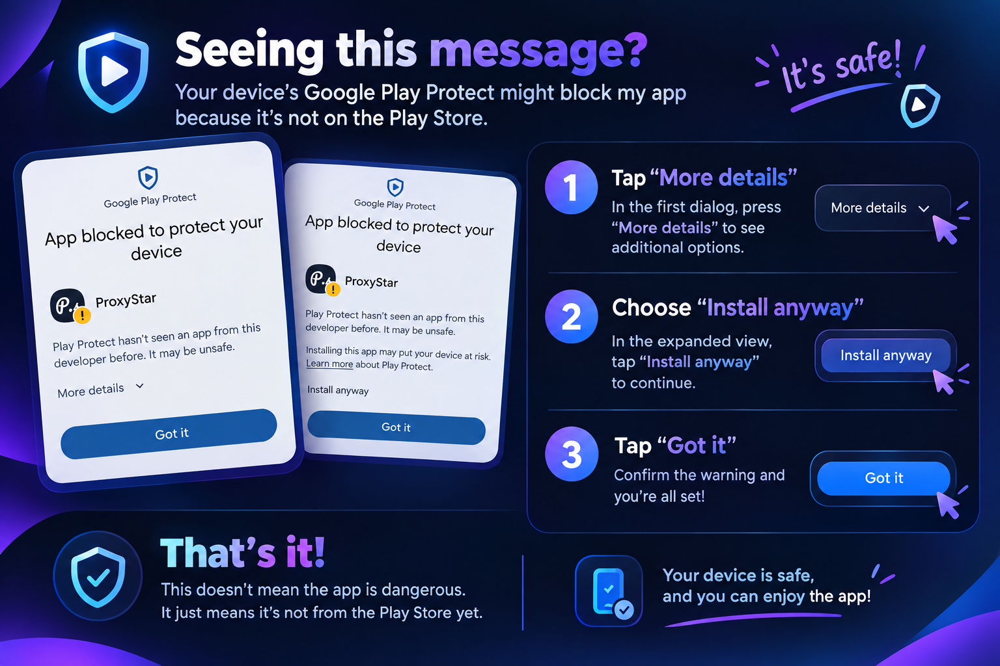

# ProxyStar

**Discover better connections. Test. Connect.**

ProxyStar is an Android application designed to discover public proxies, measure connectivity and latency, and help users find better-performing servers under changing network conditions.

## Features

- **Public Proxy Discovery** — Collect proxy entries from configured public sources.
- **Live Connectivity Checks** — Check server availability.
- **Latency Testing** — Measure response times to help compare servers.
- **Smart Server Sorting** — Prioritize servers based on connection quality.
- **Network-Aware Recommendations** — Help users identify suitable servers as network conditions change.
- **Curated Server Selection** — Access a collection of over 1,000 selected servers.

## Download

Get the latest Android APK from the official GitHub Releases page:

**[Download ProxyStar](../../releases/latest)**

For announcements and updates, visit the [ProxyStar Telegram channel](https://t.me/Proxystar_Channel).

## Installation Notice

**Android may display a security warning when installing ProxyStar.**

Because ProxyStar is distributed outside Google Play, Android or Google Play Protect may display a warning or restrict installation. However, distribution outside Google Play does not necessarily mean an app is malicious, and the warning alone does not establish the exact reason for a block.

### How to proceed

If Android displays a warning:

1. Make sure you downloaded the APK from the official [ProxyStar Releases page](../../releases/latest).
2. Read the warning carefully and verify the file's source.
3. If the warning offers **More details** and then **Install anyway**, you may be able to continue after reviewing the information and deciding to trust the file.
4. If Android reports a specific threat, the installation remains blocked, or you cannot verify the APK, cancel the installation.

**Do not disable Google Play Protect just to install the application.** Installation options vary by Android version, device manufacturer, and warning type. Never bypass a warning you do not understand.

For additional information, consult Google's documentation:

- [Google Play Protect](https://support.google.com/googleplay/answer/2812853)
- [Download apps to your Android device](https://support.google.com/android/answer/9457058)
- [Distributing apps outside Google Play](https://developer.android.com/distribute/marketing-tools/alternative-distribution)

### Visual Installation Guide

See the illustrated installation guide below for a visual explanation of the installation process.

## Technology

- Kotlin
- Android Studio
- Python for supporting tools

## Project Status

Released for Android.

This repository distributes compiled application releases and project documentation. The application's source code is not included.

## Disclaimer

ProxyStar works with publicly available proxy endpoints. Availability, speed, reliability, and suitability may vary depending on your network and the proxy provider. A successful connectivity check does not guarantee privacy, security, or anonymity.

ProxyStar is distributed outside Google Play. No claim of independent security certification is made here. Users should verify the APK's source and review security warnings before installation.

Use proxy services responsibly and comply with applicable laws and service terms.

## License

ProxyStar is proprietary software. All rights reserved unless otherwise stated. No permission to redistribute, modify, or reuse the application is granted by this notice.
